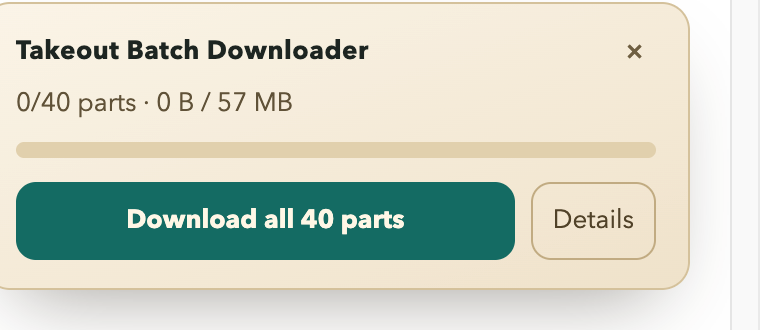
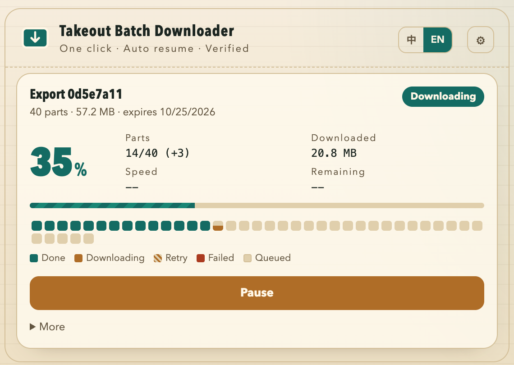

<p align="center">
  
</p>

<h1 align="center">Takeout Batch Downloader</h1>

<p align="center">
  <b>One click to download every part of a Google Takeout export — queued, auto-resumed, retried and verified.</b><br/>
  <a href="README.zh-CN.md">中文说明</a> ·
  <a href="docs/USER_GUIDE.md">User guide</a> ·
  <a href="docs/ARCHITECTURE.md">Architecture</a> ·
  <a href="docs/PRIVACY.md">Privacy</a>
</p>

---

Exporting Google Photos with [Google Takeout](https://takeout.google.com) gives you dozens or hundreds of
2 GB zip files, each with its own **Download** button. Clicking them one by one is slow and error-prone: Chrome
blocks "multiple downloads", Google keeps asking you to sign in again, connections drop, and you end up with
duplicates like `takeout-…-009 (1).zip` and no idea which parts are still missing.

This Chrome extension adds a **Download all** button to the Takeout page and takes care of the rest.

<p align="center">
  
  &nbsp;
  
</p>

## Features

| | |
|---|---|
| **One-click batch download** | Detects every part on the "Manage exports" page and queues them all. |
| **Concurrency control** | Download 1–6 parts at a time; the rest wait in line. |
| **Auto resume & retry** | Network drops resume where they stopped (HTTP Range). Server errors retry with exponential back-off. A part with no progress for 5 minutes is re-queued. |
| **No duplicates** | Parts already downloaded in this browser, currently downloading, or clicked manually on the page are recognised and skipped. |
| **Sign-in handling** | When Google asks you to verify it's you, the queue pauses, the Takeout tab opens and you get a notification. As soon as you verify, downloading continues on its own. |
| **Data cap** | Stop after *N* GB per run — handy on metered connections. |
| **Download window** | Only download during set hours (e.g. overnight). |
| **Keep awake** | Prevents the computer from sleeping while downloads run. |
| **Size check** | A file that is clearly too small (truncated, or an HTML page instead of a zip) is downloaded again. |
| **Expiry reminder** | Shows when the links expire and highlights it when it's close. |
| **Integrity check** | Export `verify-takeout.sh`: runs `unzip -t` on every part and writes a report. Also exports a CSV manifest. |
| **Manual fixes** | Mark parts you already have, or force selected parts to download again. |
| **Bilingual UI** | English and 简体中文, follows the browser language or switch with one click. |

## Install

The extension is not on the Chrome Web Store yet. Install it from source:

1. Download this repository (**Code → Download ZIP**) and unzip it, or `git clone` it.
2. Open `chrome://extensions` and turn on **Developer mode** (top right).
3. Click **Load unpacked** and choose the `extension/` folder.

Works in Chrome 120+ and other Chromium browsers (Edge, Brave, Arc).

> **Saving to an external drive:** Chrome Settings → Downloads → Location → pick a folder on the drive.
> The extension puts files into a `Google Takeout/` subfolder there (configurable).

## Use

1. Create an export at [takeout.google.com](https://takeout.google.com). For photos, choose only **Google Photos**.
   Pick `.zip` and the largest part size you're comfortable with.
2. When Google emails you, open **Manage exports → Download your files**. Google may ask you to sign in first.
3. Click **Download all N parts** in the bottom-right panel. You can close that tab; progress lives in the toolbar icon.
4. If Google asks you to verify again, do it in the tab that opens — downloading resumes automatically.
5. When everything is done: **More → Export verify script**, then in a terminal, in the download folder:

   ```bash
   bash verify-takeout.sh
   # ...
   # total=166 ok=166 bad=0 missing=0
   # ALL GOOD
   ```

See the full [user guide](docs/USER_GUIDE.md) for settings, troubleshooting and tips for very large exports.

## What it does *not* do

- It never deletes anything from Google Photos or your Google account.
- It cannot sign in for you; passwords and passkeys are always entered by you, on Google's own page.
- It does not upload your data anywhere. Everything stays in your browser and your disk — see [PRIVACY.md](docs/PRIVACY.md).

## Development

```bash
node --test tests/*.test.mjs        # unit tests + service worker against a fake chrome.* API
node harness/e2e.mjs                # real Chrome + local mock Takeout server
PARTS=166 PART_BYTES=400000 node harness/e2e.mjs
UI_LANG=en node harness/e2e.mjs     # run with the English UI
tools/pack.sh                       # build dist/takeout-batch-downloader-<version>.zip
```

No dependencies to install — only Node.js 20+ and Google Chrome.

The end-to-end test starts Chrome with a throw-away profile and routes all traffic to a local mock of
`takeout.google.com`, so it never touches a real Google account. It checks the concurrency limit, a mid-transfer
network drop resumed with a Range request, a sign-in prompt in the middle of the run, no duplicate files, and that
the verify script reports `ALL GOOD`.

See [ARCHITECTURE.md](docs/ARCHITECTURE.md) for how the pieces fit together.

## Disclaimer

This is an independent project and is not affiliated with or endorsed by Google. Google Takeout's page layout may
change at any time; if part detection stops working, please open an issue.

## License

[MIT](LICENSE)
