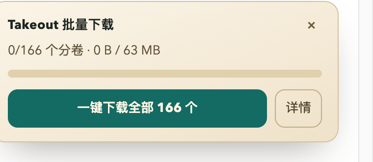
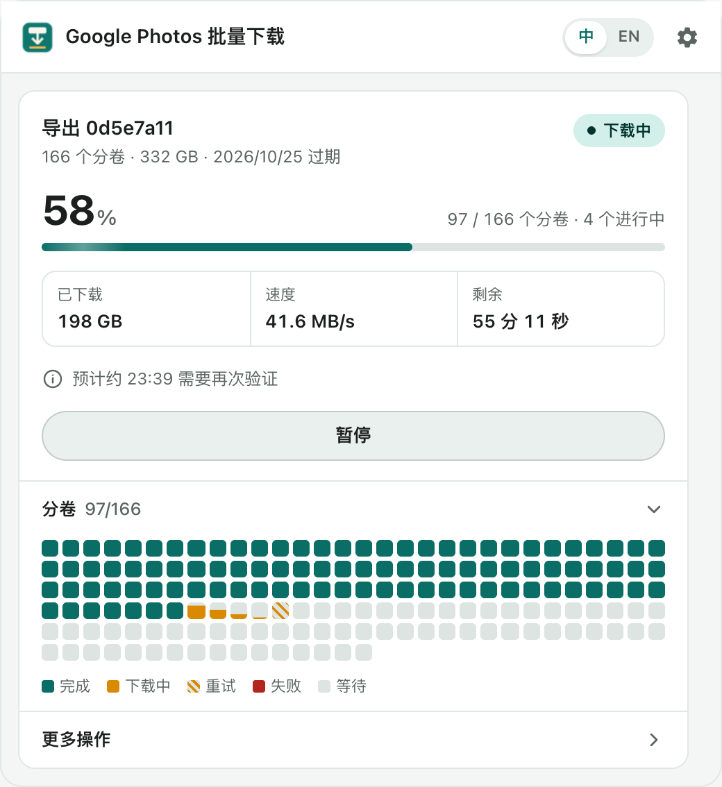

<p align="center">
  
</p>

<h1 align="center">Takeout 批量下载器</h1>

<p align="center">
  <b>一键下载 Google Takeout 导出的全部分卷：自动排队、断点续传、失败重试、完整校验。</b><br/>
  <a href="README.md">English</a> ·
  <a href="docs/USER_GUIDE.zh-CN.md">使用指南</a> ·
  <a href="docs/ARCHITECTURE.md">架构说明（英文）</a> ·
  <a href="docs/PRIVACY.zh-CN.md">隐私说明</a>
</p>

---

用 [Google Takeout](https://takeout.google.com) 导出 Google 相册，会得到几十甚至上百个 2GB 的 zip 分卷，每个都要单独点“下载”。
一个个点不仅慢，还容易出问题：Chrome 拦截“自动下载多个文件”，Google 反复要求重新验证身份，网络一断就要重来，
最后还会冒出 `takeout-…-009 (1).zip` 这样的重复文件，搞不清到底还缺哪几个。

这个 Chrome 插件会在 Takeout 页面上加一个**“一键下载全部”**按钮，剩下的事情交给它。

<p align="center">
  
  &nbsp;
  
</p>

## 功能

| | |
|---|---|
| **一键批量下载** | 自动识别“管理导出”页面上的所有分卷，全部加入队列。 |
| **并发控制** | 可设同时下载 1–6 个，其余排队等待。 |
| **断点续传与重试** | 断网后从断点继续（HTTP Range）；服务器出错按指数退避自动重试；5 分钟没有进度的分卷会重新排队。 |
| **不重复下载** | 浏览器里已经下完、正在下载、或在页面上手动点过的分卷都会被识别并跳过。 |
| **身份验证处理** | Google 要求验证身份时自动暂停、打开 Takeout 页面并发通知；验证完成后自动继续。 |
| **流量上限** | 每轮最多下载 N GB，到量自动暂停，适合按流量计费的网络。 |
| **下载时段** | 只在指定时间段下载，比如夜间。 |
| **防休眠** | 下载期间阻止电脑休眠。 |
| **大小检查** | 文件明显偏小（下载中断、或拿到的是网页而不是 zip）会自动重下。 |
| **过期提醒** | 显示下载链接的过期日期，临近时高亮提示。 |
| **完整性校验** | 导出 `verify-takeout.sh`，对每个分卷执行 `unzip -t` 并生成报告；还能导出 CSV 清单。 |
| **手动修正** | 可以把已有的分卷标记为“已有”，或强制重新下载指定分卷。 |
| **中英双语界面** | 默认跟随浏览器语言，也可一键切换。 |

## 安装

目前还没有上架 Chrome 应用商店，请从源码安装：

1. 下载本仓库（**Code → Download ZIP** 后解压），或 `git clone`。
2. 在 Chrome 打开 `chrome://extensions`，打开右上角的**开发者模式**。
3. 点**加载已解压的扩展程序**，选择 `extension/` 文件夹。

支持 Chrome 120 及以上版本，以及 Edge、Brave、Arc 等 Chromium 内核浏览器。

> **想直接存到移动硬盘：** Chrome 设置 → 下载内容 → 位置，选择硬盘上的文件夹。
> 插件会在里面建一个 `Google Takeout/` 子文件夹（可在设置里修改）。

## 使用

1. 在 [takeout.google.com](https://takeout.google.com) 创建导出。只备份照片的话，只勾选 **Google 相册**；
   文件类型选 `.zip`，分卷大小按需选择。
2. 收到 Google 的邮件后，打开**管理导出 → 下载您的文件**页面（Google 可能先要求验证身份）。
3. 点页面右下角浮窗里的**一键下载全部 N 个**。之后这个页面可以关掉，进度在浏览器工具栏图标里查看。
4. 如果 Google 再次要求验证，在弹出的页面里完成即可，验证后会自动继续下载。
5. 全部完成后：**更多操作 → 导出校验脚本**，然后在下载文件夹里打开终端运行：

   ```bash
   bash verify-takeout.sh
   # ...
   # total=166 ok=166 bad=0 missing=0
   # ALL GOOD
   ```

设置项说明、常见问题和超大导出的建议，请看完整的[使用指南](docs/USER_GUIDE.zh-CN.md)。

## 它不会做的事

- 不会删除 Google 相册或 Google 账号里的任何内容。
- 不会替你登录；密码和通行密钥始终由你本人在 Google 自己的页面上输入。
- 不会把你的数据上传到任何地方，所有数据只在你的浏览器和硬盘里，详见[隐私说明](docs/PRIVACY.zh-CN.md)。

## 开发

```bash
node --test tests/*.test.mjs        # 单元测试 + 用模拟 chrome.* API 驱动后台脚本的集成测试
node harness/e2e.mjs                # 真实 Chrome + 本地模拟 Takeout 服务器的端到端测试
PARTS=166 PART_BYTES=400000 node harness/e2e.mjs
UI_LANG=en node harness/e2e.mjs     # 用英文界面运行
tools/pack.sh                       # 打包 dist/takeout-batch-downloader-<版本>.zip
node tools/store-assets.mjs         # 生成 Chrome 应用商店截图和宣传图
```

Chrome 应用商店的文案、隐私问卷答案、图片和上架清单都在 [`store/`](store/README.zh-CN.md)。

不需要安装任何依赖，只要 Node.js 20+ 和 Google Chrome。

端到端测试会用一次性的临时 Chrome 配置启动浏览器，并把所有流量导向本地模拟的 `takeout.google.com`，不会碰真实的 Google 账号。
测试覆盖：并发上限、传输中途断网后用 Range 请求续传、下载中途要求验证身份、没有重复文件、校验脚本输出 `ALL GOOD`。

## 免责声明

本项目是独立开发的，与 Google 没有任何关联，也未获得 Google 的认可。Google Takeout 的页面结构随时可能变化，
如果插件识别不到分卷，欢迎提交 issue。

## 许可证

[MIT](LICENSE)
